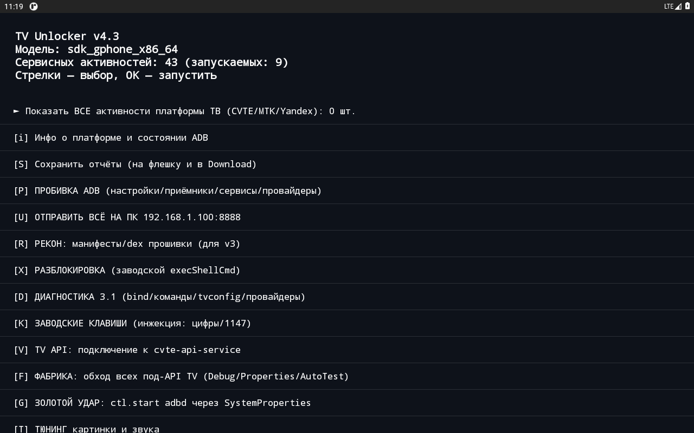

# TV Unlocker

Инструмент для телевизоров на Яндекс ТВ (YaOS), у которых производитель вырезал из меню
пункты отладки. Приложение устанавливается прямо на телевизор и через скрытые компоненты
прошивки включает сетевой ADB (порт 5555), после чего телевизором можно управлять
с компьютера: ставить приложения, править настройки, делать скриншоты, чистить мусор.

Проверено на Hyundai H-LED40BS5003 (YaOS 4.x, Android 11, плата CVTE TP.MT9256.PB722,
ядро 4.19.116). С высокой вероятностью работает на родственных платах CVTE/MTK
(TP.MT9256.PB7xx, CV9256 и т.п.) с Яндекс ТВ и Салют ТВ.



## Зачем это нужно

На телевизорах с YaOS производители нередко выпиливают «Отладку по сети» из настроек:
семь нажатий на номер сборки ничего не дают, экран «Для разработчиков» пустой, порт 5555
закрыт. Рут-права при этом отсутствуют, а прошивки под такие платы с открытым ADB
в открытом доступе нет.

TV Unlocker решает проблему без прошивки и без root: приложение перебирает легитимные
системные механизмы — от скрытых активностей до заводских AIDL-сервисов — и включает
adbd средствами самой прошивки.

## Установка

Скачайте APK со страницы Releases и установите одним из способов:

- скопировать на флешку (FAT32), открыть файловым менеджером на телевизоре;
- либо по сети с компьютера:

```
adb connect <IP телевизора>:5555
adb install TV-Unlocker-4.3.apk
```

Приложение появляется в общем списке приложений телевизора.

## Использование

Запустите TV Unlocker — он просканирует прошивку и покажет список найденных сервисных
активностей. Стрелки — выбор, OK — выполнить.

| Пункт | Что делает |
|---|---|
| `[i] Инфо о платформе` | модель, версия Android, `adb_enabled`, ключевые system properties |
| `[S] Сохранить отчёты` | выгружает полный отчёт: getprop, все активности/сервисы/приёмники/провайдеры всех пакетов |
| `[P] ПРОБИВКА ADB` | перебирает пути включения ADB: запись в Settings, broadcast по словарю action-строк, сервисы, провайдеры |
| `[U] ОТПРАВИТЬ ВСЁ НА ПК` | отправляет отчёты по HTTP на компьютер (см. [приёмник](#приёмник-на-компьютере)) |
| `[R] РЕКОН` | извлекает строки из манифестов и dex вендорских APK — карта скрытых компонент прошивки |
| `[X] РАЗБЛОКИРОВКА` | подключается к заводскому сервису и пытается вызвать его shell-методы |
| `[D] ДИАГНОСТИКА` | подробный протокол: почему bind отклонён, ответы провайдеров, конфиги /vendor/tvconfig |
| `[K] ЗАВОДСКИЕ КЛАВИШИ` | инжекция клавиш через заводской сервис (цифры для сервисных кодов пульта) |
| `[F] ФАБРИКА` | обход всех под-API платформы (`ITvApiManager` и ~150 дочерних интерфейсов) |
| `[V] TV API` | прямое подключение к `ITvApiManager` с дампом методов |
| `[G] РАБОЧАЯ РАЗБЛОЖИКА` | главное: `SystemProperties.set` от system-uid — `service.adb.tcp.port=5555`, `ctl.start adbd` |
| `[T] ТЮНИНГ` | настройка картинки и звука: шумодавы и «улучшайзеры» off, режим STANDARD, AVL on |

Все действия протоколируются в `tvunlocker_*.txt` (Download на ТВ, папка `TVUnlocker`
на флешке, отправка на ПК). Это позволяет разобрать любой отказ по шагам.

### Что происходит при успехе

`[G]` (а на части прошивок — уже `[P]`) выставляет `service.adb.tcp.port=5555` и
перезапускает `adbd` через вендорский сеттер системных свойств. Дальше на компьютере:

```
adb connect <IP телевизора>:5555
adb devices        # должно появиться device
```

На телевизоре ничего подтверждать не нужно: на этих прошивках `ro.adb.secure=0`.
Затем ADB включается на постоянку (`settings put global adb_enabled 1` выполняется
автоматически при первом подключении) и переживает перезагрузку.

После этого доступны: установка приложений (`adb install`), скриншоты (`screencap`),
доступ к `/sdcard`, отключение предустановленных пакетов (`pm disable-user` /
`pm uninstall --user 0`, обратимо), запуск любых интентов и настроек.

## Приёмник на компьютере

Кнопки `[U]`/`[R]`/`[G]` могут отправлять протоколы прямо на компьютер. Для приёма
запустите `scripts/listener.py` (Python 3, без зависимостей) и откройте порт 8888
в брандмауэре:

```
python scripts/listener.py
netsh advfirewall firewall add rule name="TV Unlocker 8888" dir=in action=allow protocol=TCP localport=8888
```

Адрес компьютера, на который отправляются файлы, задан константой `PC_PRIMARY`
в `src/ru/tvunlocker/TVUnlocker.java` — перед сборкой поменяйте на свой.

## Сборка из исходников

Нужны JDK 17, Android SDK (build-tools 34.0.0, platform android-34) иGradle не требуется —
сборка выполняется напрямую утилитами SDK. Подробности и готовый скрипт: [docs/BUILD.md](docs/BUILD.md).

```
scripts/build.sh          # Linux/macOS/Git Bash
scripts/build.bat         # Windows
```

Готовый APK также приложен в разделе Releases.

## Как это устроено

Кратко о механизмах, в порядке эффективности на прошивке H-LED40BS5003:

1. **AIDL к вендорскому сервису.** На плате живёт сервис `com.cvte.tv.api.impl`
   (`/system/app/cvte-api-service/`), экспортирующий `ITvApiManager` — фабрику ~150
   под-API управления телевизором. Компонентные bind'ы YaOS блокирует, но bind
   по action-строке `com.cvte.tv.api.TV_API_SERVICE` проходит. Интерфейс загружается
   из APK сервиса через `DexClassLoader`, `asInterface` выполняется над живым binder'ом.
2. **Сеттер свойств от system-uid.** Под-API `getTVApiSystemProperties` даёт
   `set(String,String)`, который исполняется от `android.uid.system`. Запись
   `service.adb.tcp.port` и `ctl.start adbd` поднимает adbd в обход
   `adb_enabled=0` — это и есть ключевой шаг `[G]`.
3. **Заводской сервис клавиш.** `com.cvte.factory.service` (тоже bind по action
   `CVTEFACSERVICE`) принимает `KeyEvent` через `handleKeyEvents` — теоретически
   позволяет вводить сервисные коды пульта программно; на части прошивок
   события фильтруются по источнику.
4. **Перебор компонент.** `PackageManager` + явные интенты: сотни активностей,
   сервисов, приёмников и провайдеров прошивки проверяются на отзывчивость
   (`[P]`, `[D]`), результаты пишутся в протокол.

Детальная история исследования (что tried и почему не сработало) — в
[docs/RESEARCH.md](docs/RESEARCH.md).

## Ограничения и известные проблемы

- Работает только на прошивках, где перечисленные вендорские сервисы экспортированы.
  На «здоровых» прошивках с закрытыми сервисами приложение честно отчитается об отказах.
- `adb_enabled` может сбрасываться после полного обесточивания телевизора —
  повторите `[G]` (10 секунд).
- Часть под-API возвращает `UnsupportedOperationException` — эти ветки
  отключены производителем на уровне прошивки.
- Google Play на YaOS установить нельзя (нет сертификации GMS) — приложения
  ставятся по ADB или через сторонние магазины.

## Дисклеймер

Инструмент изменяет настройки вашего телевизора. Автор не несёт ответственности
за последствия: возможен сброс настроек, нестабильная работа оболочки и другие
неожиданности. Не трогайте в заводских меню пункты Panel Type, LVDS, White Balance,
Backlight, Shipping Init. Всё, что делает приложение, обратимо стандартными
средствами (`pm enable`, `cmd package install-existing`).

## Благодарности

Исследование опирается на работу сообщества:

- [4PDA: Яндекс SMART TV](https://4pda.to/forum/index.php?showtopic=1000256) и
  [Телевизоры на шасси CV9632xx / CVTE](https://4pda.to/forum/index.php?showtopic=1058309)
- [cleanyourtv / CleanMyTV](https://github.com/wingedpanther/cleanmytv) — debloat-списки
  и идея работы с лаунчером через ADB

## Лицензия

[MIT](LICENSE)

## Поддержать проект

Если TV Unlocker помог разблокировать ваш телевизор — можно поддержать разработку:

**[ЮMoney — перевести](https://yoomoney.ru/fundraise/1LNFQM9TLJ6.261122)**
